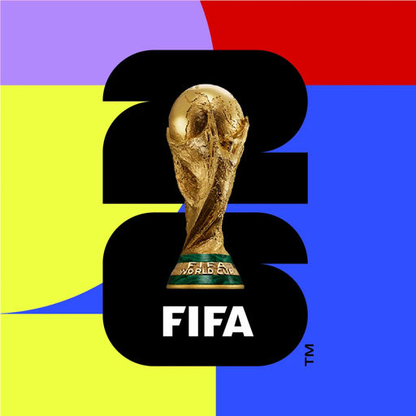
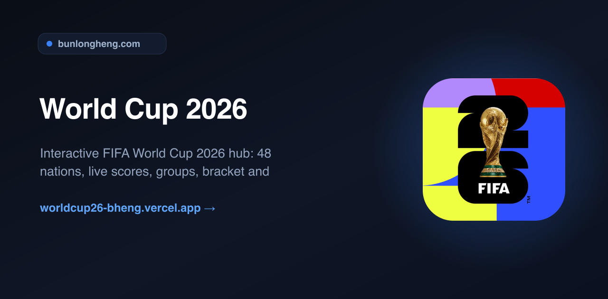
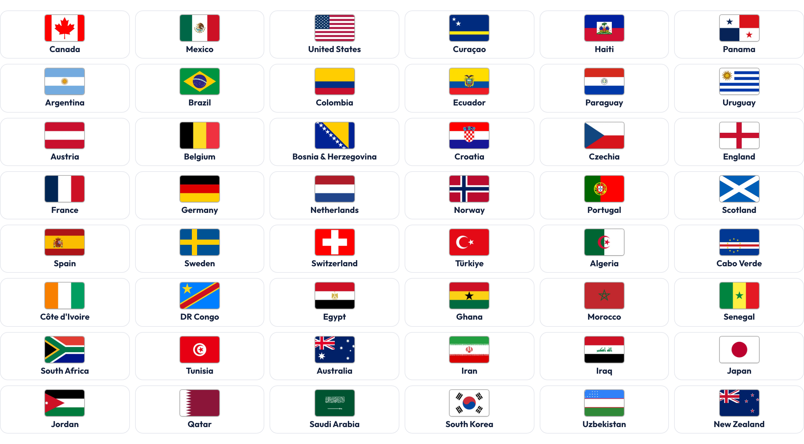
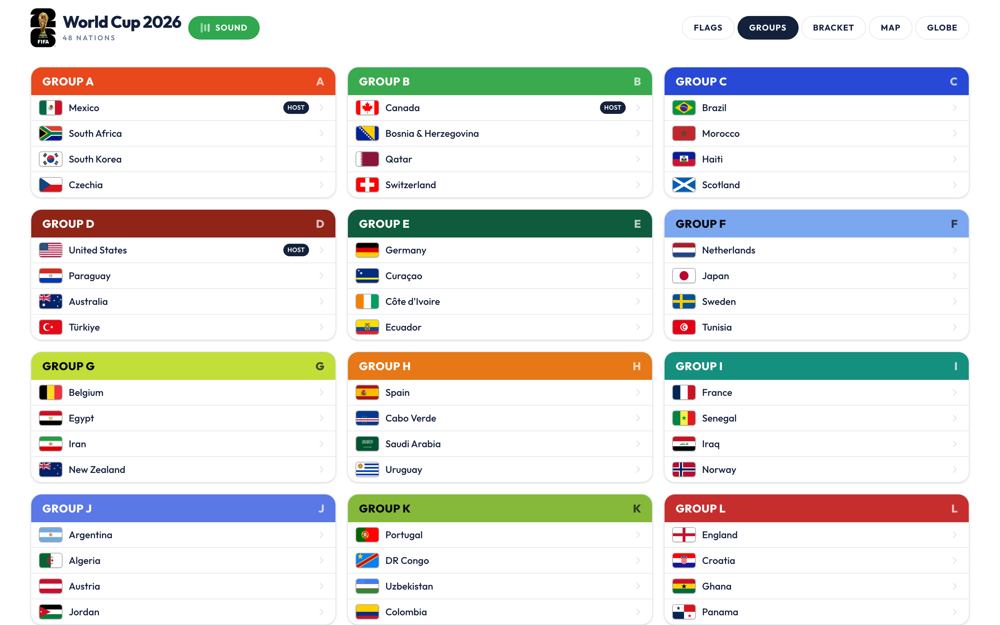
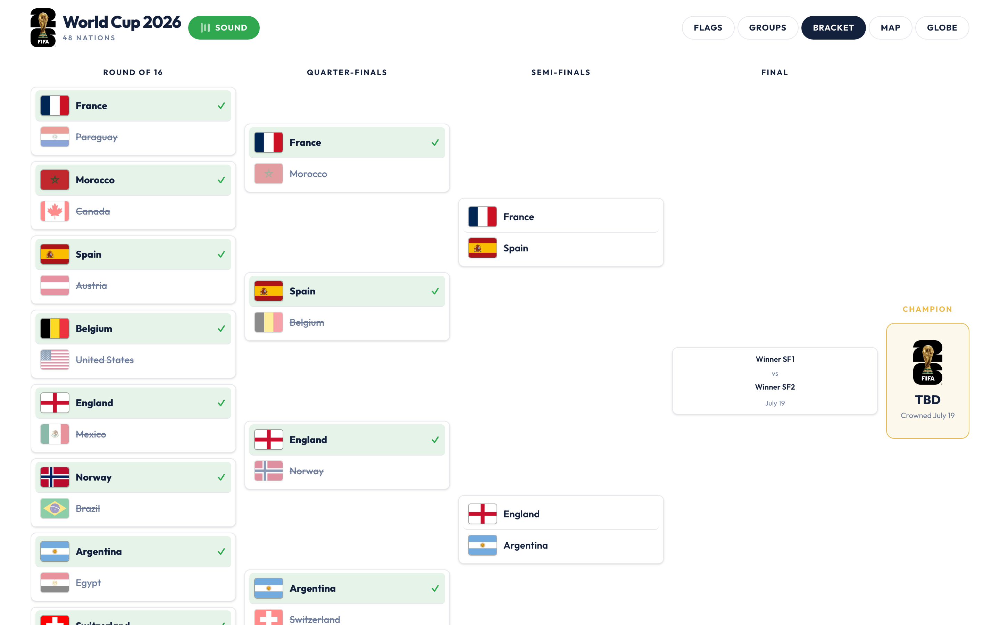
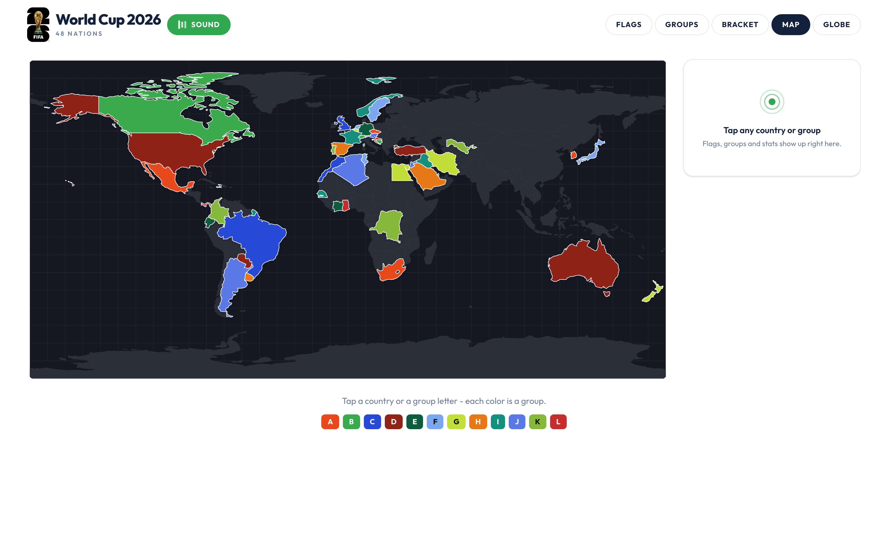
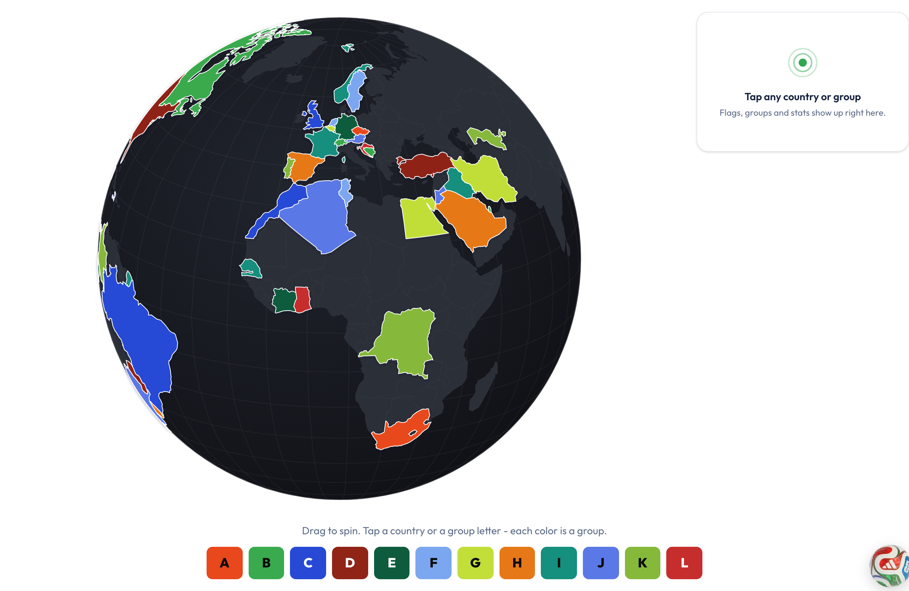
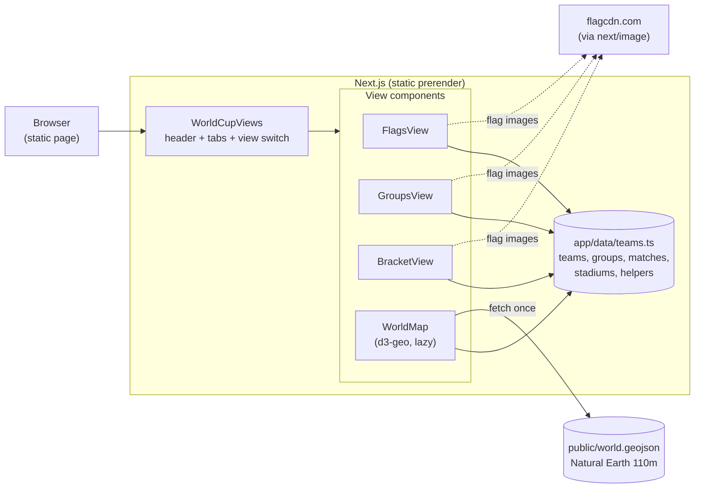

<div align="center">
  
  <h1>World Cup 2026</h1>
  <p><em>Interactive FIFA World Cup 2026 hub: 48 nations, live scores, groups, bracket and a 3D globe</em></p>
  <p><a href="https://worldcup26-bheng.vercel.app">Live</a> &middot; <a href="https://github.com/bunlongheng/worldcup26">Repo</a> &middot; <a href="https://bunlongheng.com/projects?name=worldcup-2026">Portfolio</a></p>
  
</div>

---

# World Cup 2026

An interactive companion for the 2026 FIFA World Cup: all 48 qualified nations in five linked views - a flag wall, color-coded groups, a live knockout bracket, and the same draw painted onto an interactive 2D world map and a draggable 3D globe. Tap any country for its stats and full match history.



[](LICENSE)


## Contents

- [Features](#features)
- [Architecture](#architecture)
- [Design decisions and trade-offs](#design-decisions-and-trade-offs)
- [Tech stack](#tech-stack)
- [Quick start](#quick-start)
- [Configuration](#configuration)
- [Testing](#testing)
- [Project layout](#project-layout)
- [License](#license)

## Features

- All 48 qualified nations with real flags, grouped by confederation with the three hosts first.
- Seven linked views - Flags, Groups, Bracket, Rank, Players, Map, and Globe - switched instantly from the header, no page loads.
- Color-coded groups: 12 groups in FIFA brand colors, with a Host badge on Canada, Mexico, and the USA.
- Live knockout bracket, Round of 32 through the Final - topology-only pairings, with every score, winner, and the derived Champion (Spain) computed live from the MATCHES data, losers struck through. Tap any team in the bracket to open its country modal (name spoken aloud, flag blurred behind).
- Final ranking (1-48) in the Rank view: the medal places come from the Final and the third-place playoff, everyone else is bucketed by how far they went then by overall record - all derived live from MATCHES.
- Players view: browse each nation's squad with real photos (via TheSportsDB, downloaded locally), plus a "guess the nation" player quiz. 47 of 48 squads (Jordan is absent from the free data source).
- One d3-geo view renders both an equirectangular 2D map and a draggable 3D globe from a single 244KB geojson.
- Tap a country or a group letter to highlight it with a glow and open the side panel; drag to spin the globe.
- Country detail modal: flag, group, confederation, capital, continent, population, area, currency, and every match with its real score (W / L / D). Opening any country modal speaks its name aloud and blurs its flag behind the card.
- Host nations open their full stadium list (16 venues) inside the same modal.
- A physics-driven floating ball on every page: drag to grab, flick to throw, and it ricochets off the window edges with real velocity-based bounces (see below).
- Official theme audio, loaded lazily and toggled from the header - nothing downloads until the first pointer tap (or the Sound toggle button) starts it.
- Fully responsive from phone to desktop with no horizontal scroll; real FIFA 26 emblem as favicon and iOS icon.

### The floating ball

A World Cup ball floats above every page (`FloatingBall.tsx`) with a small physics engine:

- **Flick to throw** - the release velocity is measured from your last ~90ms of drag, so a hard flick flies far and bounces many times, a gentle one barely moves.
- **Real bounces** - it reflects off all four window edges keeping 72% of its energy each hit, with a rolling spin, then settles and idles (the animation loop sleeps at rest to save battery).
- **Shake to ignite** - wiggle it left/right fast: 3+ reversals leave a black-and-grey smoke trail, 6+ set it on fire and the next throw launches at 5x speed, with a canvas particle trail.
- It stays above modals but never covers the header, and the smoke/fire canvas is `pointer-events: none` so it never blocks a tap.

The bug-prone math (release velocity, wall bounce, shake detection) is isolated in `ballPhysics.ts` and unit-tested.

Tap the ball 10 times for a hidden golden-ball skin swap (glitter burst + chime); 10 more taps swaps it back.

### The five views

| Groups | Bracket |
|--------|---------|
|  |  |
| **Map** | **Globe** |
|  |  |

## Architecture

World Cup 2026 is a fully static Next.js app - no backend, no database, no API routes. One server shell mounts a lean client app-shell that switches between view components, and every view reads from a single typed data module. The map and globe are one lazy-loaded d3-geo component that draws two projections from one Natural Earth geojson.



One data module, one direction of flow:

| Layer | Files | Role |
|-------|-------|------|
| Shell | `app/page.tsx`, `app/components/WorldCupViews.tsx` | Static server page mounts the client app-shell (header, tabs, view switch) |
| Views | `app/components/views/*`, `app/components/WorldMap.tsx` | Flags, Groups, Bracket (pure) + the lazy d3-geo Map/Globe |
| Data | `app/data/teams.ts` | Single source: 48 teams, 12 groups, 103 matches, 16 stadiums, country stats + lookups (`TEAM_BY_NAME`, `matchesFor`) |
| Leaf | `Flag`, `Logo`, `ThemeSong`, `CountryCard` | Small presentational pieces reused across views |
| Overlay | `FloatingBall.tsx` + `ballPhysics.ts` | Physics ball + canvas smoke/fire, mounted once in the root layout; pure math split out and tested |
| Assets | `public/world.geojson`, `public/theme.mp3` | Slimmed Natural Earth geometry + the theme clip |

`WorldMap` is loaded with `next/dynamic` (`ssr: false`), so d3-geo and the geojson stay out of the initial bundle until you open the Map or Globe tab. The same component swaps between `geoEquirectangular` (flat map) and `geoOrthographic` (globe) on a single prop.

## Design decisions and trade-offs

The whole app optimizes for one thing: a fast, offline-friendly, zero-backend tournament board a kid can explore. Every choice below follows from that.

| Decision | Chosen | Alternative | Why this trade-off | Cost we accept |
|----------|--------|-------------|--------------------|----------------|
| Data source | Static TypeScript module | CMS / database / live API | Zero backend, instant static prerender, versioned in git and unit-tested | Match results are updated by editing code after games are played |
| Rendering | Fully static (no SSR, no API) | Server components with data fetch | Deploys to any static or edge host, instant TTFB, nothing to run | No personalization or live-updating scores |
| Map + globe | One d3-geo component, two projections | Mapbox / Leaflet / vector tiles | No API key, no tile server; one 244KB geojson drives both 2D and 3D | Hand-rolled interaction, no deep zoom or pan |
| Flags | flagcdn via `next/image` | Bundle 48 SVGs in the repo | Crisp at any size, optimized and cached by the image pipeline, tiny repo | A runtime dependency on a third-party host |
| Theme audio | Native `<audio>`, `preload="none"` | Autoplay / eager preload | ~751KB is fetched only on a user gesture; the page stays light | Manual play; the clip is the heaviest asset |
| View state | Local `useState` switch | A route segment per view | One-page instant switching, no navigation cost | Views are not individually deep-linkable |

## Tech stack

- Next.js 16 (App Router, Turbopack, static prerender)
- React 19, TypeScript in strict mode
- Tailwind CSS v4
- d3-geo - `geoOrthographic` globe + `geoEquirectangular` map, over Natural Earth 110m geometry
- flag images from [flagcdn.com](https://flagcdn.com) through `next/image`
- node:test unit tests (28) + Playwright e2e (4), ESLint 9 flat config, GitHub Actions CI
- Hosted on Vercel

## Quick start

```bash
git clone https://github.com/bunlongheng/worldcup26.git
cd worldcup26
npm install
npm run dev
```

Open http://localhost:3009. The build is static, so `npm run build && npm start` serves the same thing with no runtime dependencies.

## Configuration

No environment variables required.

## Testing

```bash
npm test          # 28 unit tests (node:test) - data invariants, ball physics, map picking
npm run test:e2e  # 4 e2e tests x 2 viewports (desktop + mobile)
npm run lint      # ESLint 9 flat config
npm run typecheck
```

`npm test` runs 28 pure-logic and data-invariant unit tests via `node --test`, across 3 files: `tests/data.test.ts` locks the core data invariants - 48 unique teams, 12 groups of 4, 3 hosts, 16 stadiums, and every match referencing a real team; `tests/ballPhysics.test.ts` covers the floating ball's release-velocity, bounce, and shake math; `tests/mapPicking.test.ts` covers the map/globe country and group highlight logic.

`npm run test:e2e` runs 4 e2e tests x 2 viewports (desktop + mobile) - `e2e/app.spec.ts` against Desktop Chromium and a Pixel 5 mobile project, 8 runs total: (1) loads all 5 views and opens a country modal, asserting real per-view content along the way - group standings in Groups, the derived Champion in Bracket, a knockout score, and the map/globe SVG rendering; (2) tapping a group filter on the map highlights that group; (3) a country modal traps focus inside it and closes on Escape; (4) the view tablist is navigable with arrow keys.

GitHub Actions runs both on every push - typecheck, lint, `npm test`, `npm run build`, then the Playwright e2e suite.

## Project layout

```
app/
  page.tsx                 static server shell
  layout.tsx               metadata, fonts, icons
  globals.css              Tailwind v4 theme tokens
  data/
    teams.ts               48 teams, groups, matches, stadiums, stats + helpers
  components/
    WorldCupViews.tsx      app shell: header, tabs, view switch
    WorldMap.tsx           d3-geo 2D map + 3D globe (lazy, client)
    mapPicking.ts          pure, tested map/globe highlight logic
    FloatingBall.tsx       physics ball + canvas smoke/fire (above all pages)
    ballPhysics.ts         pure, tested ball math (velocity, bounce, shake)
    useDialog.ts           focus-trap + Escape-to-close hook for modals
    Flag.tsx               next/image flag
    Logo.tsx               FIFA 26 emblem
    ThemeSong.tsx          lazy theme-audio toggle
    CountryCard.tsx        country detail card
    views/
      FlagsView.tsx        48-flag grid + country modal
      GroupsView.tsx       12 groups + match center + stadium list
      BracketView.tsx      knockout bracket
public/
  world.geojson            Natural Earth 110m geometry (244KB)
  theme.mp3                official theme clip
  ball.png                 the floating World Cup ball sprite
  ball-2026.webp           golden-ball skin, easter egg (tap the ball 10x)
  wc26-logo.png            emblem
tests/
  data.test.ts             data-integrity assertions
  ballPhysics.test.ts      ball physics assertions
  mapPicking.test.ts       map/globe highlight-logic assertions
e2e/
  app.spec.ts              Playwright: all 5 views + modal focus-trap + Escape
.github/workflows/ci.yml   typecheck, lint, test, build, e2e
```

## License

[MIT](LICENSE) (c) 2026 Bunlong Heng

---

<p align="center">
  <sub>Built by <a href="https://bunlongheng.com">Bunlong Heng</a> &middot; <a href="https://bunlongheng.com/projects/worldcup-2026">See it in my portfolio &rarr;</a></sub>
</p>

---

<div align="center">

<a href="https://bunlongheng.com"></a>
<a href="https://www.linkedin.com/in/bunlongheng/"></a>
<a href="https://www.instagram.com/ibunlong/"></a>
<a href="mailto:bheng.code@gmail.com"></a>

<br>

Built by **[Bunlong](https://bunlongheng.com)** &nbsp;&middot;&nbsp; [more apps](https://bunlongheng.com/projects)

</div>
